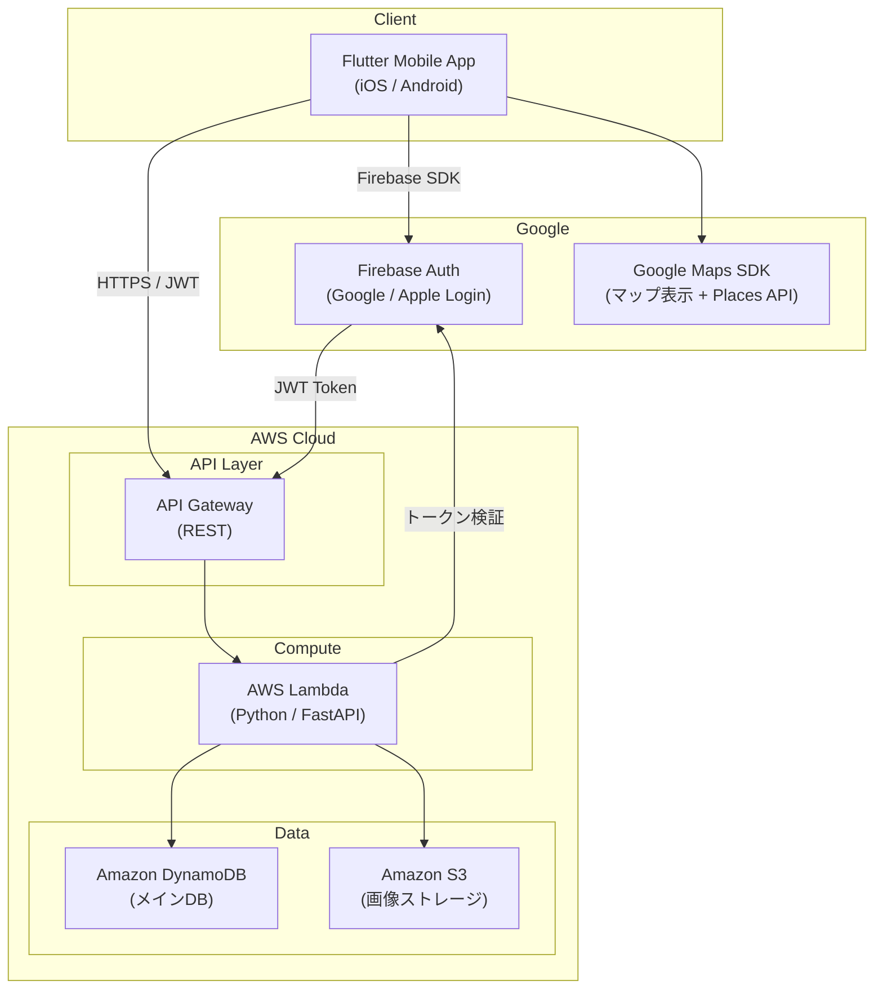
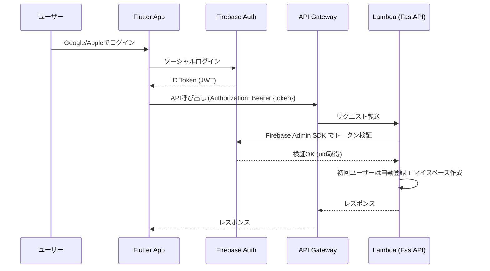
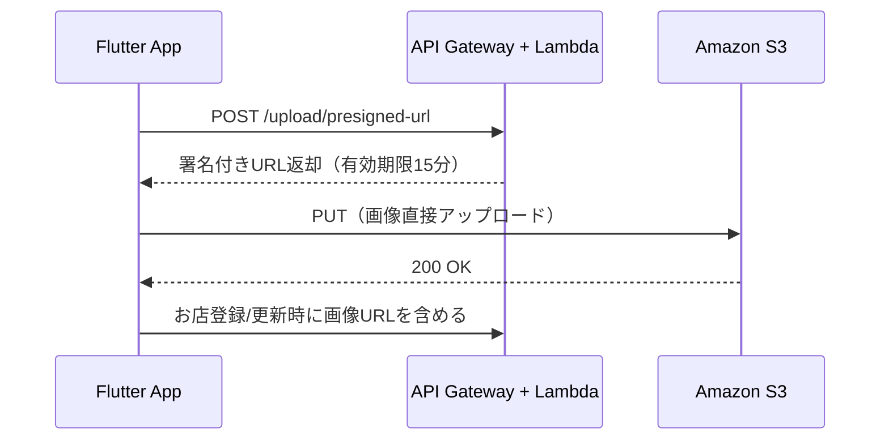

# favorite-shops - アーキテクチャ設計書

## メタデータ

| 項目 | 内容 |
|------|------|
| ステータス | Draft |
| 作成日 | 2026-03-14 |
| 更新日 | 2026-03-14 |

### 関連ドキュメント

| ドキュメント | 概要 |
|-------------|------|
| [client-architecture.md](./client-architecture.md) | Flutter クライアント設計 |
| [database-design.md](./database-design.md) | DynamoDB テーブル設計・アクセスパターン |
| [infrastructure.md](./infrastructure.md) | インフラ設計（Terraform・環境分離・デプロイ） |

---

## 1. システム全体構成



### 設計方針

- **サーバレスアーキテクチャ**: AWS Lambda + API Gateway + DynamoDB でランニングコストゼロ（永久無料枠内）
- **クライアント・サーバ分離**: REST API を介した明確な責務分離
- **モバイルファースト**: Flutter で iOS / Android 同時対応
- **認証外部化**: Firebase Auth で Google / Apple ログインをマネージド化

---

## 2. 技術スタック

### バックエンド

| 要素 | 技術 | 選定理由 |
|------|------|----------|
| 言語 | Python 3.12+ | エコシステムが豊富。型ヒント + mypy で堅く書ける |
| 型チェック | mypy (strict) | 静的型チェックで品質保証 |
| バリデーション | Pydantic v2 | リクエスト/レスポンスの型定義 + バリデーション |
| Linter/Formatter | Ruff | 高速なLinter + Formatter |
| テスト | pytest | 関数ベースのテスト |
| 認証 | Firebase Admin SDK | JWT トークンの検証 |
| AWS連携 | boto3 | DynamoDB / S3 アクセス |

※ フレームワーク（FastAPI等）は使用しない。API Gateway がルーティングを担い、各Lambda関数はドメイン単位で独立して動作する。

### フロントエンド

| 要素 | 技術 | 選定理由 |
|------|------|----------|
| フレームワーク | Flutter | iOS / Android クロスプラットフォーム |
| 状態管理 | Riverpod | 型安全でテスタビリティが高い |
| HTTPクライアント | Dio | インターセプターでJWTトークン自動付与 |
| マップ | google_maps_flutter | Google Maps SDK の Flutter ラッパー |
| 認証 | firebase_auth | Firebase Auth の Flutter SDK |

### コスト見積もり

| サービス | 無料枠 | 想定使用量 | 月額コスト |
|----------|--------|------------|-----------|
| Lambda | 1M req/月 (永久) | 〜数千 | $0 |
| API Gateway | 1M req/月 (永久) | 〜数千 | $0 |
| DynamoDB | 25GB, 25 WCU/RCU (永久) | 〜数MB | $0 |
| S3 | 5GB (永久) | 〜数百枚 | $0 |
| Firebase Auth | 5万MAU | 〜数十人 | $0 |
| Google Maps | $200/月クレジット | 少量 | $0 |
| **合計** | | | **$0** |

---

## 3. バックエンドアーキテクチャ

### 構成方針

- **ドメイン単位の Lambda 関数**: 各ドメイン（お店、グループ等）ごとに1つのLambda関数を持つ
- **Lambda Layer で共通コードを共有**: 認証、DB接続、設定等はLayerとして全関数から参照
- **API Gateway がルーティングを担当**: パス + HTTPメソッドに基づいて対応するLambda関数を呼び出す
- **ハンドラ内のCRUD分岐は固定**: HTTPメソッドによる振り分けのみ。新機能は新しいLambda関数として追加

### Lambda 関数一覧

| Lambda関数名 | 対応リソース | HTTPメソッド |
|-------------|-------------|-------------|
| `auth` | `/auth/*` | POST |
| `users` | `/users/*` | GET, PUT |
| `shops` | `/groups/{id}/shops/*`, `/users/me/shops/*` | GET, POST, PUT, DELETE |
| `groups` | `/groups/*` | GET, POST |
| `menus` | `/shops/{id}/menus/*` | GET, POST, DELETE |
| `upload` | `/upload/*` | POST |

### ディレクトリ構成

```
backend/
├── layers/
│   └── shared/                    # Lambda Layer（全関数で共有）
│       ├── auth.py                # Firebase トークン検証
│       ├── db.py                  # DynamoDB クライアント
│       ├── config.py              # 環境設定
│       └── models/                # 共通 Pydantic モデル
├── functions/
│   ├── auth/
│   │   ├── handler.py             # エントリーポイント（HTTPメソッドで分岐）
│   │   ├── service.py             # ビジネスロジック
│   │   └── models.py              # リクエスト/レスポンスモデル
│   ├── shops/
│   │   ├── handler.py
│   │   ├── service.py
│   │   └── models.py
│   ├── groups/
│   │   ├── handler.py
│   │   ├── service.py
│   │   └── models.py
│   ├── menus/
│   │   ├── handler.py
│   │   ├── service.py
│   │   └── models.py
│   └── upload/
│       ├── handler.py
│       └── service.py
├── tests/
│   ├── functions/                 # 関数ごとのテスト
│   │   ├── test_shops_service.py  # お店機能のテスト（= 詳細設計書）
│   │   ├── test_groups_service.py
│   │   └── ...
│   └── conftest.py                # 共通フィクスチャ（モック等）
└── pyproject.toml
```

### 設計原則

- **ドメイン単位構成**: ドメインごとにLambda関数を分割。新機能追加時は新しい関数を作るだけで既存コードを触らない
- **ドメイン独立**: 各Lambda関数は自ドメインのデータのみ返す。他ドメインの構造に依存しない
- **Pydanticでデータを堅く定義**: リクエスト/レスポンス/ドメインモデルすべて型付き
- **関数ベース + 必要に応じてクラス**: 小さいうちは関数で、複雑になったらクラスに育てる
- **mypy strict**: 型チェックをCIで強制
- **テスタビリティ**: 外部依存（DB、認証）は引数で受け取り、テスト時にモックを注入可能にする。本番コードの変更なしでテスト可能
- **テスト駆動**: 振る舞いを定義する Small テストを先に書き、詳細設計書として機能させる

### データ取得方針

各APIは自ドメインのデータのみ返し、フロントエンド側で必要なAPIを並列に呼び出して画面を組み立てる。

| 画面 | API呼び出し |
|------|------------|
| お店一覧 | `GET /groups/{id}/shops`（1回） |
| お店詳細 | `GET /groups/{id}/shops/{shopId}` + `GET /shops/{shopId}/menus` + `GET /shops/{shopId}/ranks`（3回並列） |
| マップ | お店一覧のレスポンスに含まれる lat/lng を使用（追加API不要） |
| 行きたいリスト / マイスペース | `GET /users/me/shops`（1回。shopName は非正規化済み） |
| グループ詳細 | `GET /groups/{id}` + `GET /groups/{id}/members`（2回並列） |

### API エンドポイント

#### 認証

| メソッド | パス | 概要 |
|----------|------|------|
| POST | `/auth/token` | Firebase トークン検証 + ユーザー登録/取得 |

#### ユーザー

| メソッド | パス | 概要 |
|----------|------|------|
| GET | `/users/me` | 自分のプロフィール取得 |
| PUT | `/users/me` | プロフィール更新 |

#### グループ

| メソッド | パス | 概要 |
|----------|------|------|
| POST | `/groups` | グループ作成（+ マイスペース自動作成） |
| GET | `/groups` | 参加中グループ一覧 |
| GET | `/groups/{groupId}` | グループ詳細 |
| POST | `/groups/{groupId}/invite` | 招待コード生成（有効期限付き） |
| POST | `/groups/join` | 招待コードでグループ参加 |
| GET | `/groups/{groupId}/members` | メンバー一覧 |

#### お店（共有グループ ＆ マイスペース共通）

| メソッド | パス | 概要 |
|----------|------|------|
| POST | `/groups/{groupId}/shops` | 共有グループにお店登録 |
| GET | `/groups/{groupId}/shops` | 共有グループのお店一覧（検索対応） |
| GET | `/groups/{groupId}/shops/{shopId}` | 共有グループのお店の詳細 |
| POST | `/users/me/shops` | マイスペースにお店登録（=行きたいリスト追加） |
| GET | `/users/me/shops` | マイスペースのお店一覧 |
| PUT | `/users/me/shops/{shopId}/status` | マイスペースのお店の状態更新（行った/行ってない/行きたい等） |
| POST | `/shops/parse-url` | URL解析してお店情報取得 |

#### おすすめメニュー

| メソッド | パス | 概要 |
|----------|------|------|
| POST | `/shops/{shopId}/menus` | メニュー追加 |
| GET | `/shops/{shopId}/menus` | メニュー一覧 |
| DELETE | `/shops/{shopId}/menus/{menuId}` | メニュー削除 |

#### ランク

| メソッド | パス | 概要 |
|----------|------|------|
| PUT | `/shops/{shopId}/rank` | 自分のランク設定・更新 |
| GET | `/shops/{shopId}/ranks` | 全メンバーのランク一覧 |

#### 画像

| メソッド | パス | 概要 |
|----------|------|------|
| POST | `/upload/presigned-url` | S3 署名付きURL取得 |

### 検索クエリパラメータ（`GET /groups/{groupId}/shops`）

| パラメータ | 型 | 説明 |
|-----------|-----|------|
| `cuisineGenre` | string | 食事ジャンル（カンマ区切り） |
| `drinkGenre` | string | 飲み物ジャンル（カンマ区切り） |
| `area` | string | エリア |
| `visited` | boolean | 行った/行ってないフィルタ（個人ベース） |
| `searchMode` | string | `and` / `or`（デフォルト: `and`） |
| `rank` | string | ランクフィルタ（カンマ区切り） |
| `q` | string | フリーワード検索 |
| `limit` | int | 取得件数（デフォルト: 20） |
| `offset` | int | オフセット（ページネーション） |

---

## 4. 認証フロー



---

## 5. 画像管理

### アップロード（署名付きURL）

Lambda のペイロード制限（6MB）を回避するため、クライアントから S3 に直接アップロードする。



### ダウンロード（パブリックアクセス）

画像の取得は S3 の公開URLを直接参照する。

- 画像はお店・メニューの写真であり機密情報ではない
- URLにUUIDを含むため推測困難
- パブリックアクセスによりキャッシュが有効に働き表示が速い
- アクセス制御はAPI層で実施（グループ外ユーザーは画像URLを取得できない）

---

## 6. ランク設計

- 点数方式ではなく、段階式のランクを採用（具体的なラベル・表示形式は実装時に決定）
- ランクは **グループメンバー各自** が設定可能（同じお店でも人によって評価が異なる）
- お店詳細画面では全メンバーのランクを表示
- 検索フィルタでは自分のランクで絞り込み

---

## 7. URL解析（お店登録の簡易化）

### 対応URL形式

| ソース | URL例 | 取得方法 |
|--------|-------|----------|
| Googleマップ | `https://maps.google.com/...` / `https://goo.gl/maps/...` | Places API（place_id抽出） |
| 食べログ | `https://tabelog.com/...` | HTMLスクレイピング（構造化データ取得） |

### 処理フロー

1. クライアントがURLをPOST (`/shops/parse-url`)
2. Lambda側でURLをパース、情報取得
3. 店名・住所・緯度経度・ジャンル等を返却
4. クライアント側でプレビュー表示 → ユーザーが確認・補完して登録

---

## 8. セキュリティ設計

| 項目 | 対策 |
|------|------|
| 認証 | Firebase Auth + JWT。Lambda内で Firebase Admin SDK によるトークン検証 |
| 認可 | Lambda内でグループ所属チェック。グループ外ユーザーのアクセスを拒否 |
| 通信 | HTTPS（API Gateway標準） |
| 画像アップロード | S3 署名付きURL（有効期限15分） |
| 画像ダウンロード | S3 パブリックアクセス（URLにUUID含み推測困難。アクセス制御はAPI層で実施） |
| 招待コード | ランダム生成 + 有効期限 + 使用済みフラグ |
