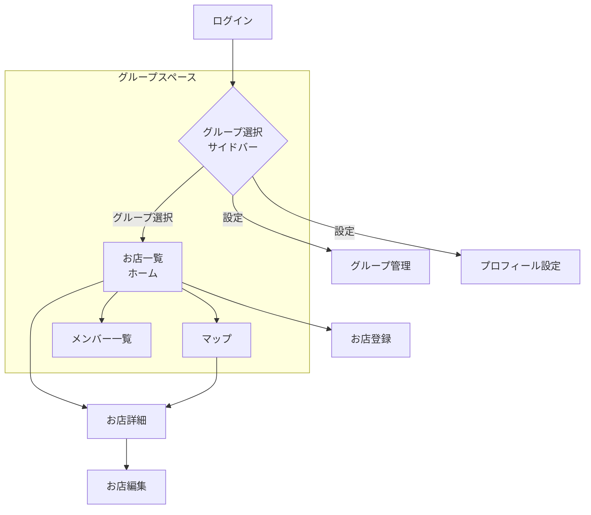

# favorite-shops - クライアントアーキテクチャ設計書

## メタデータ

| 項目 | 内容 |
|------|------|
| ステータス | Draft |
| 作成日 | 2026-03-14 |
| 更新日 | 2026-03-14 |
| 親ドキュメント | [architecture.md](./architecture.md) |

---

## 1. 技術スタック

| 要素 | 技術 | 選定理由 |
|------|------|----------|
| フレームワーク | Flutter | iOS / Android クロスプラットフォーム |
| 言語 | Dart | Flutter標準 |
| 状態管理 | Riverpod | 型安全でテスタビリティが高い |
| HTTPクライアント | Dio | インターセプターでJWTトークン自動付与 |
| ルーティング | go_router | 宣言的ルーティング、ディープリンク対応 |
| マップ | google_maps_flutter | Google Maps SDK の Flutter ラッパー |
| 認証 | firebase_auth | Firebase Auth の Flutter SDK |
| ローカルストレージ | SharedPreferences | 簡易キャッシュ・設定保存 |

---

## 2. ディレクトリ構成

```
lib/
├── main.dart
├── app/
│   ├── app.dart                       # MaterialApp, ルーティング設定
│   └── theme.dart                     # テーマ定義（カラー、タイポグラフィ）
├── features/
│   ├── auth/
│   │   ├── login_screen.dart
│   │   ├── auth_provider.dart
│   │   └── auth_repository.dart
│   ├── group_space/                   # 📱 グループスペース（親コンテナUI）
│   │   ├── components/                # サイドバー、ボトムナビ等（例: group_sidebar.dart）
│   │   ├── group_space_screen.dart    # タブとサイドバーを持つ大枠の画面
│   │   └── group_space_provider.dart  # 選択中のグループIDを保持する状態
│   ├── shop/                          # 📦 各タブの中身（ドメイン機能）
│   │   ├── components/                
│   │   ├── list/
│   │   │   ├── components/            
│   │   │   ├── shop_list_screen.dart  # 「お店一覧」タブの中身
│   │   │   └── shop_list_provider.dart
│   │   ├── detail/
│   │   │   ├── shop_detail_screen.dart
│   │   │   └── shop_detail_provider.dart
│   │   ├── register/
│   │   │   ├── shop_register_screen.dart
│   │   │   └── shop_register_provider.dart
│   │   ├── shop_repository.dart
│   │   └── shop_model.dart
│   ├── group/
│   │   ├── manage/
│   │   │   ├── group_manage_screen.dart
│   │   │   └── group_manage_provider.dart
│   │   ├── members/
│   │   │   ├── group_members_screen.dart  # メンバー一覧
│   │   │   └── group_members_provider.dart
│   │   ├── group_repository.dart
│   │   └── group_model.dart
│   ├── map/
│   │   ├── map_screen.dart
│   │   └── map_provider.dart
│   └── profile/
│       ├── profile_screen.dart
│       └── profile_provider.dart
└── shared/
    ├── components/                    # アプリ全体で共有する汎用UI（例: custom_button.dart）
    ├── api_client.dart                # Dio 設定（ベースURL、トークン自動付与）
    └── auth_state.dart                # 認証状態（グローバル、各featureから参照）
```

### 構成方針

- **Feature > 画面 で分割**: 各feature内を画面（list / detail / register等）で分け、画面固有の screen と provider をまとめる
- **UIコンポーネント（Widget）の分割・配置ルール**:
  - `shared/components/`: アプリ全体で使い回す汎用Widget（カスタムボタン、共通ダイアログ等）
  - `features/{feature}/components/`: そのFeature（ドメイン）内で使い回すWidget（例: shop機能に対する `shop_card.dart`）
  - `features/{feature}/{screen}/components/`: 1ファイルが長くなるのを防ぐための、その画面専用の分割Widget
- **ドメイン共有ファイルは feature 直下**: repository（API通信）と model（データモデル）は画面横断で共有するため feature 直下に配置
- **shared は最小限**: 本当にfeature横断で必要なもの（汎用UI、API クライアント設定、認証状態）のみ
- **画面が1つの feature はフラット**: wishlist や map のように画面が1つしかない場合、無理にサブディレクトリを切らない

---

## 3. 設計原則

- **画面単位の状態管理**: 各画面に対応する Provider を持ち、画面の状態を管理。Riverpod の `AsyncNotifierProvider` でAPI通信と状態管理を統一
- **Repository パターン**: API通信は repository に集約。Provider から repository を呼び出す
- **go_router**: 宣言的にルーティングを定義。ディープリンク対応
- **並列データ取得**: お店詳細等、複数APIを呼ぶ画面では Riverpod の Provider を組み合わせて並列取得

---

## 4. 画面構成

### 画面一覧

| # | 画面名 | Feature / 画面 | 主な機能 |
|---|--------|---------------|----------|
| 1 | ログイン | auth | Google / Apple ソーシャルログイン |
| 2 | グループスペース（ホーム） | shop / list | 選択中グループのお店のタイムライン/一覧、検索・フィルタ |
| 3 | お店詳細 | shop / detail | 写真、ジャンル、コメント、メニュー、ランク、マップ |
| 4 | お店登録 | shop / register | リンク入力（自動取得）/ 手動入力フォーム |
| 5 | マップ | map | 選択中グループのお店のピン表示 |
| 6 | メンバー一覧 | group / members | グループ参加メンバー一覧 |
| 7 | グループ管理 | group / manage | 招待コード生成、グループ設定 |
| 8 | プロフィール設定 | profile | プロフィール編集 |

### 画面遷移（Discordライク）



### ナビゲーション構造

- **Drawer または サイドバー**で「参加中グループ」を切替（Discordのサーバー選択のイメージ）
- **マイスペース（個人用グループ）** も一つのグループとしてサイドバーに統合（「行きたいリスト」はマイスペース内のお店として扱う）
- 選択されたグループ内で、**BottomNavigationBar**（またはそれに類するタブ）を使って「お店一覧」「マップ」「メンバー」を切り替える
- グループ管理やプロフィール設定は、サイドバーの設定アイコン等から遷移

