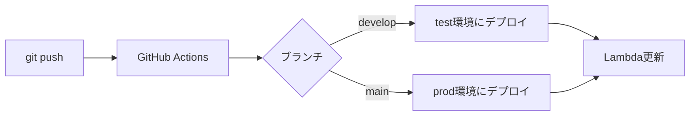

# favorite-shops - インフラ設計書

## メタデータ

| 項目 | 内容 |
|------|------|
| ステータス | Draft |
| 作成日 | 2026-03-14 |
| 更新日 | 2026-03-14 |
| 親ドキュメント | [architecture.md](./architecture.md) |

---

## 1. 概要

### インフラ構成

| サービス | 用途 | 永久無料枠 |
|----------|------|-----------|
| API Gateway (REST API) | APIエンドポイント管理 | 1M req/月 |
| AWS Lambda | バックエンド処理（Python / FastAPI） | 1M req/月, 400K GB秒 |
| DynamoDB | メインデータベース | 25GB, 25 WCU/RCU |
| S3 | 画像ストレージ | 5GB |
| Firebase Auth | 認証（Google / Apple） | 5万MAU |
| Google Maps Platform | マップ表示・Places API | $200/月クレジット |

### IaC ツール

**Terraform** を使用してAWSリソースを管理する。

---

## 2. 環境分離

### 環境一覧

| 環境 | 用途 | 命名規則（リソースプレフィックス） |
|------|------|--------------------------------|
| `test` | テスト・開発用 | `favorite-shops-test-*` |
| `prod` | 本番用 | `favorite-shops-prod-*` |

### 環境ごとの差異

| 設定項目 | test | prod |
|---------|------|------|
| Lambda メモリ | 128MB | 256MB |
| Lambda タイムアウト | 30秒 | 30秒 |
| DynamoDB キャパシティ | オンデマンド | オンデマンド |
| S3 バケット名 | `favorite-shops-test-images` | `favorite-shops-prod-images` |
| API Gateway ステージ | `test` | `prod` |
| Firebase プロジェクト | 共通（環境変数で切替） | 共通 |
| ログレベル | DEBUG | INFO |

---

## 3. Terraform ディレクトリ構成

```
infra/
├── modules/                       # 再利用可能なモジュール
│   ├── api-gateway/
│   │   ├── main.tf
│   │   ├── variables.tf
│   │   └── outputs.tf
│   ├── lambda/
│   │   ├── main.tf
│   │   ├── variables.tf
│   │   └── outputs.tf
│   ├── dynamodb/
│   │   ├── main.tf
│   │   ├── variables.tf
│   │   └── outputs.tf
│   └── s3/
│       ├── main.tf
│       ├── variables.tf
│       └── outputs.tf
├── envs/                          # 環境別設定
│   ├── test/
│   │   ├── main.tf               # モジュール呼び出し
│   │   ├── variables.tf
│   │   ├── terraform.tfvars      # 環境固有の値（.gitignore対象）
│   │   ├── backend.tf            # tfstate保存先
│   │   └── outputs.tf
│   └── prod/
│       ├── main.tf
│       ├── variables.tf
│       ├── terraform.tfvars
│       ├── backend.tf
│       └── outputs.tf
└── README.md                     # セットアップ手順
```

### 設計思想

- **モジュール分割**: リソース種別ごとにモジュール化し、環境間で再利用
- **環境分離**: `envs/` 配下に環境ごとのディレクトリを持ち、値のみ変更
- **変数化**: 環境依存の値はすべて `variables.tf` + `terraform.tfvars` で管理
- **最小権限の原則**: IAMポリシーは各Lambda関数に必要最小限の権限のみ付与

---

## 4. tfstate 管理

### S3 + DynamoDB バックエンド

| リソース | 用途 |
|---------|------|
| S3 バケット `favorite-shops-tfstate` | tfstate ファイル保存（暗号化有効） |
| DynamoDB テーブル `favorite-shops-tfstate-lock` | 同時実行ロック |

- 環境ごとに `key` を分離（例: `prod/terraform.tfstate`, `test/terraform.tfstate`）
- tfstate 管理用リソースは Terraform 管理外で事前に手動作成（ブートストラップ）

---

## 5. 主要リソース定義

### Lambda

- ランタイム: Python 3.12
- ハンドラ: Mangum 経由で FastAPI を起動
- 環境変数: `ENVIRONMENT`, `DYNAMODB_TABLE`, `S3_BUCKET`, `FIREBASE_PROJECT_ID`
- 命名規則: `{project}-{environment}-api`（例: `favorite-shops-prod-api`）

### API Gateway

- REST API タイプを使用
- Lambda プロキシ統合（全リクエストをLambdaに転送）
- カスタムドメインは将来的に設定（初期は API Gateway のデフォルトURL）

### DynamoDB

- オンデマンドキャパシティモード（プロビジョンド不要で無料枠内）
- TTL 有効化（招待コードの自動削除用）
- GSI1 を定義

### S3

- アップロード: 署名付きURL経由（Lambda が発行）
- ダウンロード: パブリック読み取りアクセス（バケットポリシーで `s3:GetObject` を許可）
- CORS 設定（Flutter アプリからの直接アップロード用）
- ライフサイクルルール: 未参照の画像を一定期間後に削除（将来的に検討）

---

## 6. IAM 設計

### Lambda 実行ロール

| 権限 | リソース | 用途 |
|------|---------|------|
| `dynamodb:GetItem`, `PutItem`, `Query`, `DeleteItem`, `UpdateItem` | メインテーブル + GSI | DB操作 |
| `s3:PutObject`, `s3:GetObject` | 画像バケット | 署名付きURL発行 |
| `logs:CreateLogGroup`, `PutLogEvents` | CloudWatch Logs | ログ出力 |

---

## 7. CI/CD

### GitHub Actions

```
.github/workflows/
├── deploy-backend.yml    # バックエンドデプロイ
└── deploy-infra.yml      # Terraform apply
```

### デプロイフロー



### デプロイステップ（バックエンド）

1. Python依存パッケージのインストール
2. mypy による型チェック
3. Ruff による lint チェック
4. pytest によるテスト実行
5. Lambda デプロイパッケージ作成（zip）
6. `aws lambda update-function-code` でデプロイ

### デプロイステップ（インフラ）

1. `terraform fmt -check`（フォーマットチェック）
2. `terraform validate`（構文チェック）
3. `terraform plan`（差分確認）
4. `terraform apply`（手動承認 or 自動適用）

---

## 8. リージョン

| リソース | リージョン | 理由 |
|---------|-----------|------|
| Lambda, API Gateway, DynamoDB, S3 | `ap-northeast-1`（東京） | ユーザーが日本のため |

---

## 9. モニタリング

| 項目 | ツール | 設定 |
|------|--------|------|
| Lambdaログ | CloudWatch Logs | 自動出力 |
| Lambdaメトリクス | CloudWatch Metrics | Errors, Duration, Throttles |
| アラート | CloudWatch Alarms | Lambda エラー率が閾値を超えた場合（将来的に設定） |

---

## 10. タグ付けポリシー

全リソースに以下のタグを付与：

| タグキー | 値 | 用途 |
|---------|-----|------|
| `Project` | `favorite-shops` | プロジェクト識別 |
| `Environment` | `test` / `prod` | 環境識別 |
| `ManagedBy` | `terraform` | 管理ツール識別 |
